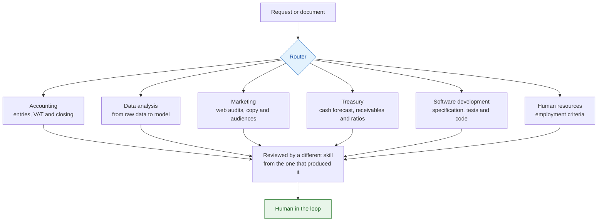
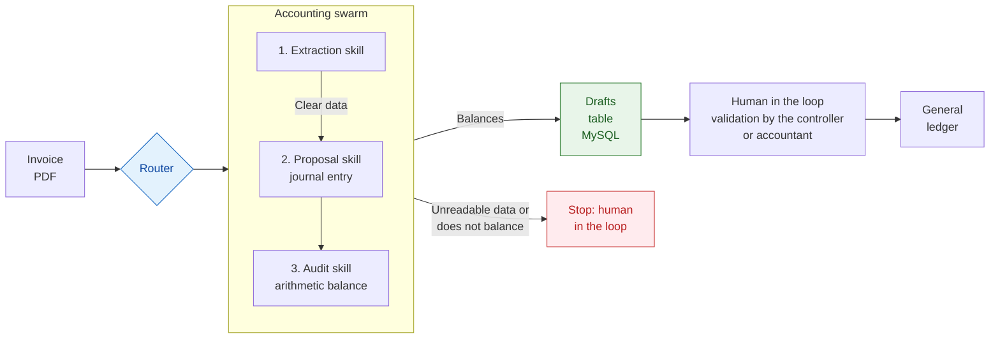
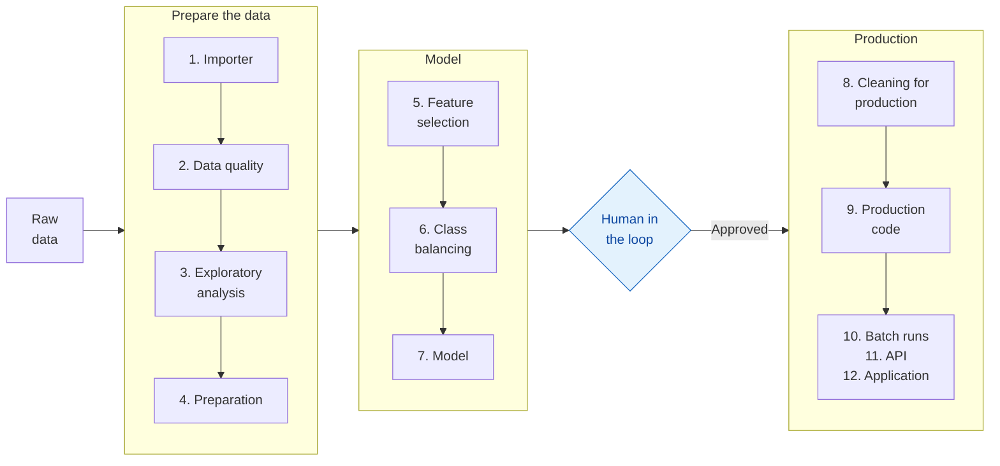

Versión en español: [README.md](README.md)

# Juan Luis León Rodríguez's portfolio

**Financial controller and data analyst · Accounting · Business Intelligence · AI systems for business**

[](https://juanluisleon.vercel.app)

     
   
   
    

This repository holds the code of my portfolio site and documents the automation system I build. It has 55 skills
grouped into six domain swarms: accounting, analytics, marketing, treasury, software development and human
resources. A router coordinates them, and they run on MySQL, Power BI, Python, n8n and Claude.

Accounting and data analysis follow the same approach, *bring your own agents*: agents of my own, each with its task
and its permissions. In accounting there are five, from the one that reads the invoice to the one that leaves the
entry in drafts. In data analysis there are twelve, from the data importer to deployment, and they take each case
from raw data to a model in production. This second workflow is not published yet.

## The system in three concepts

- **Skill.** A text file that gives a model its working criteria. It sets which rules to apply, which accounts to
  use and when to stop and ask a person to review.
- **Swarm.** A group of skills specialised in the same domain. They split the work with segregation of duties: the
  skill that reviews is never the one that produced the data.
- **Router.** The central piece that reads each request and sends it to the right swarm. Thanks to it, the system can
  grow without breaking.

## The system at a glance



The rule is the same in all six: whoever produces is not whoever reviews, and anything that changes data or gets
published is decided by a person.

## Two cases end to end

### Accounting: posting a supplier invoice



1. **Extraction.** A supplier invoice PDF comes in. A skill extracts the data and marks the document as unreadable
   rather than inventing a missing field.
2. **Proposal.** A second skill drafts the journal entry with the company's chart of accounts.
3. **Audit.** A third skill checks that the entry balances and decides whether it moves on or stops.
4. **Human supervision.** Approved entries go to a drafts table. None reaches the ledger on its own: a person moves
   it there after validating it.

### Data analysis: one case from raw data to a model in production



Twelve agents of my own, one per task. Each step leaves its files on disk, and nothing counts as done until what the
agent says it did has been checked.

## The method: validate before use

In finance, an agent without controls is a risk. That is why 23 skills have automated evaluations run, with their
results stored. Another 30 have partial coverage. On top of that, every change to the system goes through a blind
simulation: a regression test that checks that what already worked still works.

## Structuring and governing AI

Open repositories on how to frame, control and check the work of a language model, with checks that do not depend
on AI. They go from basic to advanced:

- [tu-primer-asistente-ia-web](https://github.com/jleonceo/tu-primer-asistente-ia-web): what an AI assistant is and
  how you instruct it, explained without jargon.
- [llm-eval-contable](https://github.com/jleonceo/llm-eval-contable): how a skill is evaluated the way you examine
  a student. Across six versions of its instructions, the model went from 33 of 50 cases right to all of them.
  With the exam corrected in July, those answers would score 48 of 50.
- [accounting-agent-swarm](https://github.com/jleonceo/accounting-agent-swarm): the accounting agent swarm
  end to end, measured in its four-agent version, with its errors explained. Over 128 documents, it decided correctly in 97.7 % of cases whether to post
  the entry or hold it for review.
- [orquestacion-enjambres-ia](https://github.com/jleonceo/orquestacion-enjambres-ia): how each request is sent to
  the right agent so that the system does not fail as it grows.
- [gobernanza-skills-analiticas](https://github.com/jleonceo/gobernanza-skills-analiticas): five checks that keep a
  skill right on real data, each born from a real failure.
- [verificacion-determinista-ia](https://github.com/jleonceo/verificacion-determinista-ia): coherence checks done
  with arithmetic, which do not depend on AI.
- [agent-memory-governance](https://github.com/jleonceo/agent-memory-governance): three pieces that keep an agent's
  long-term memory from turning into a junkyard.
- [claude-code-context-management](https://github.com/jleonceo/claude-code-context-management): how to keep the
  context files small and current without flooding the model's window.
- [tesoreria-forecast-ia](https://github.com/jleonceo/tesoreria-forecast-ia): a cash forecast checked against the
  past, liquidity ratios and the age of receivables and payables. One month ahead it is off by 4,334 € on average,
  against 5,082 € for the same month of the previous year plus the trend.
- [control-interno-fraude-ia](https://github.com/jleonceo/control-interno-fraude-ia): eight audit tests on the
  ledger. On a sample ledger they find the seven planted anomalies without flagging any of the four legitimate
  cases.
- [audience-analyst-swarm](https://github.com/jleonceo/audience-analyst-swarm): the same method applied to another
  domain, audience analytics, with the swarm pattern and the exploration method of the data-analysis swarm.
- [pii-output-gate](https://github.com/jleonceo/pii-output-gate): an output gate that blocks any text carrying
  personal data without trusting the model to behave.
- [guardianes-verificados-ia](https://github.com/jleonceo/guardianes-verificados-ia): how to check that a safety
  filter really protects: it is broken on purpose and the alarm is required to fire.
- [gobernanza-agentes-verificada](https://github.com/jleonceo/gobernanza-agentes-verificada): the rules of an agent
  system wired to the code that enforces them, rather than left only written in a document.

## Data analysis

Before automating with AI you have to master data analysis. These are the starting analyses. Several of
them later became the basis for building the agents:

- [analisis-contable](https://github.com/jleonceo/analisis-contable): the income statement and bank movements of one
  financial year, from the ledger. The 2024 profit, 592,245.36 €, matches to the cent the closing entry, which
  comes from another table.
- [RFM-Customer-Analytics](https://github.com/jleonceo/RFM-Customer-Analytics): the customer base split into five
  groups by how recently, how often and how much they buy. The 246 best customers are 26 % of the base and 66.5 %
  of sales.
- [lead-scoring-ml](https://github.com/jleonceo/lead-scoring-ml): which contact the sales team calls first. Calling
  only the top-scored 20 % of the list reaches half of the buyers.
- [accident-intelligent-agent](https://github.com/jleonceo/accident-intelligent-agent): Madrid's open data on road
  accidents, from a spreadsheet to MySQL, with a model that is right in 71 % of cases.
- [de-datos-en-bruto-a-decisiones](https://github.com/jleonceo/de-datos-en-bruto-a-decisiones): a raw sales file
  analysed end to end, with a [website](https://de-datos-en-bruto-a-decisiones.vercel.app) that tells the results.

## Stack

React · Vite · deployed on Vercel.

## Run locally

```bash
npm install
npm run dev
```

## Contact

jleonceo@gmail.com · [LinkedIn](https://www.linkedin.com/in/jlleonrodriguez/) · [GitHub](https://github.com/jleonceo) · [CV](https://jleonceo.github.io/cv/)
