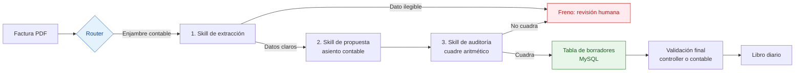

English version: [README.en.md](README.en.md)

# Portfolio de Juan Luis León Rodríguez

**Controller financiero · Business Intelligence · IA aplicada a la contabilidad**

[](https://juanluisleon.vercel.app)


Este repositorio contiene el código de mi portfolio web y documenta el sistema de automatización que construyo. Son
55 skills repartidas en seis enjambres de dominio: contabilidad, análisis, marketing, tesorería, programación y
recursos humanos. Las coordina un router y se apoyan en MySQL, Power BI, Python, n8n y Claude.

## El sistema en tres conceptos

- **Skill.** Un fichero de texto que le da criterio operativo a un modelo. Define qué reglas aplicar, qué cuentas
  contables usar y cuándo detenerse para pedir revisión humana.
- **Enjambre.** Un grupo de skills especializadas en un mismo dominio. Se reparten el trabajo con segregación de
  funciones: la skill que revisa nunca es la misma que produjo el dato.
- **Router.** La pieza central que lee cada petición y la dirige al enjambre adecuado. Gracias a ella, el sistema
  puede crecer sin romperse.

## Un caso de principio a fin: la contabilización de una factura



1. **Extracción.** Entra el PDF de una factura de proveedor. Una skill extrae los datos y marca el documento como
   ilegible antes que inventarse un campo vacío.
2. **Propuesta.** Una segunda skill redacta el asiento con el plan de cuentas de la empresa.
3. **Auditoría.** Una tercera skill comprueba el cuadre y decide si el asiento avanza o se frena.
4. **Supervisión humana.** Los asientos aprobados pasan a una tabla de borradores. Ninguno llega solo al libro
   diario: lo lleva una persona, después de validarlo.

## El método: validar antes de usar

En finanzas, un agente sin controles es un riesgo. Por eso 23 skills tienen evaluaciones automáticas ejecutadas,
con sus resultados guardados. Otras 30 tienen cobertura parcial. Además, cualquier cambio en el sistema pasa una
simulación ciega: una prueba de no regresión que comprueba que lo que ya funcionaba sigue funcionando.

## Estructurar y gobernar la IA

Repositorios abiertos sobre cómo encuadrar, controlar y comprobar el trabajo de un modelo de lenguaje, con
comprobaciones que no dependen de la IA. Van ordenados de lo básico a lo avanzado:

- [tu-primer-asistente-ia-web](https://github.com/jleonceo/tu-primer-asistente-ia-web): qué es un asistente de IA
  y cómo se le instruye, explicado sin tecnicismos.
- [llm-eval-contable](https://github.com/jleonceo/llm-eval-contable): cómo se evalúa una skill como se examina a un
  alumno. A lo largo de seis versiones de sus instrucciones, el modelo pasó de acertar 33 de 50 casos a acertarlos todos.
- [accounting-agent-swarm](https://github.com/jleonceo/accounting-agent-swarm): un enjambre de cuatro agentes
  contables de principio a fin, con sus errores explicados. Sobre 128 documentos, decidió bien en el 97,7 % de los casos
  si había que registrar el asiento o pararlo para revisión.
- [orquestacion-enjambres-ia](https://github.com/jleonceo/orquestacion-enjambres-ia): cómo se decide a qué agente
  va cada petición para que el sistema no falle al crecer.
- [gobernanza-skills-analiticas](https://github.com/jleonceo/gobernanza-skills-analiticas): cinco comprobaciones
  para que una skill siga acertando con datos reales, cada una nacida de un fallo real.
- [verificacion-determinista-ia](https://github.com/jleonceo/verificacion-determinista-ia): comprobaciones de
  coherencia hechas con aritmética, que no dependen de la IA.
- [agent-memory-governance](https://github.com/jleonceo/agent-memory-governance): tres piezas para que la memoria a
  largo plazo de un agente no se convierta en un vertedero.
- [claude-code-context-management](https://github.com/jleonceo/claude-code-context-management): cómo mantener los
  ficheros de contexto ligeros y al día sin saturar la ventana del modelo.
- [tesoreria-forecast-ia](https://github.com/jleonceo/tesoreria-forecast-ia): previsión de caja contrastada con el
  pasado, ratios de liquidez y antigüedad de cobros y pagos. A un mes vista se equivoca de media en 4.334 €, frente
  a 5.082 € del mismo mes del año anterior más la tendencia.
- [control-interno-fraude-ia](https://github.com/jleonceo/control-interno-fraude-ia): ocho pruebas de auditoría
  sobre el libro diario. En un libro de ejemplo encuentran las siete anomalías plantadas sin marcar ninguno de los
  cuatro casos legítimos.
- [audience-analyst-swarm](https://github.com/jleonceo/audience-analyst-swarm): el mismo método aplicado a otro
  dominio, la analítica de audiencias, con el patrón de enjambre y el método de exploración del análisis de datos.
- [pii-output-gate](https://github.com/jleonceo/pii-output-gate): una puerta de salida que bloquea cualquier texto
  con datos personales sin fiarse de que el modelo se porte bien.
- [guardianes-verificados-ia](https://github.com/jleonceo/guardianes-verificados-ia): cómo se comprueba que un
  filtro de seguridad protege de verdad: se rompe a propósito y se exige que salte la alarma.
- [gobernanza-agentes-verificada](https://github.com/jleonceo/gobernanza-agentes-verificada): reglas de un sistema
  de agentes cableadas al código que las hace cumplir, en lugar de dejarlas solo escritas en un documento.

## Análisis de datos

Antes de automatizar con IA hay que saber leer el negocio. Estos son los análisis de partida. Varios sirvieron
después de base para construir los agentes:

- [analisis-contable](https://github.com/jleonceo/analisis-contable): la cuenta de resultados y el movimiento del
  banco de un ejercicio, a partir del libro diario. El beneficio de 2024, 592.245,36 €, coincide al céntimo con el
  asiento de cierre, que sale de otra tabla.
- [RFM-Customer-Analytics](https://github.com/jleonceo/RFM-Customer-Analytics): la cartera de clientes dividida en
  cinco grupos según lo reciente, lo frecuente y lo mucho que compran. Los 246 mejores clientes son el 26 % de la
  cartera y el 66,5 % de las ventas.
- [lead-scoring-ml](https://github.com/jleonceo/lead-scoring-ml): a qué contacto llama primero el equipo comercial.
  Llamando solo al 20 % mejor puntuado de la lista se llega a la mitad de los compradores.
- [accident-intelligent-agent](https://github.com/jleonceo/accident-intelligent-agent): los datos abiertos de
  accidentes de tráfico de Madrid, de una hoja de cálculo a MySQL, con un modelo que acierta el 71 % de los casos.
- [de-datos-en-bruto-a-decisiones](https://github.com/jleonceo/de-datos-en-bruto-a-decisiones): un fichero de
  ventas en bruto analizado de principio a fin, con una [web](https://de-datos-en-bruto-a-decisiones.vercel.app)
  que cuenta los resultados.

## Stack

React · Vite · desplegado en Vercel.

## Ejecutar en local

```bash
npm install
npm run dev
```

## Contacto

jleonceo@gmail.com · [LinkedIn](https://www.linkedin.com/in/jlleonrodriguez/) · [GitHub](https://github.com/jleonceo) · [CV](https://jleonceo.github.io/cv/)
